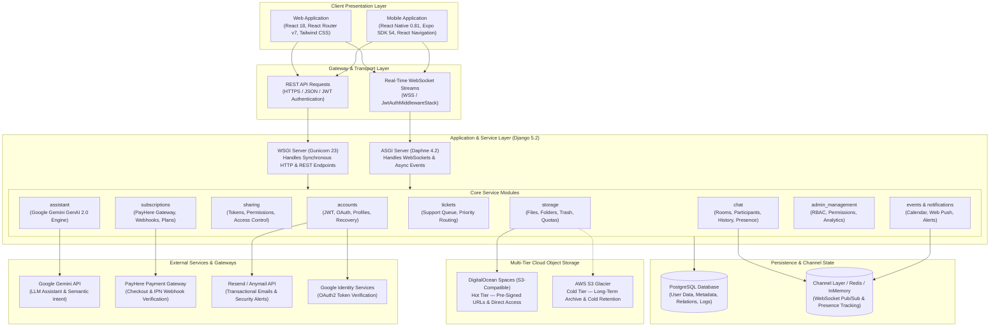

# ☁️ CEYNOA — Smart, Secure & Affordable Cloud Storage Solution

<div align="center">


**An enterprise-grade, multi-platform cloud storage and collaboration ecosystem designed for seamless file management, multi-tiered cloud archival, real-time client communication, support ticketing, and intelligent AI assistance.**

[Key Features](#-key-features) • [Architecture](#-system-architecture) • [Technology Stack](#-technology-stack) • [Repository Layout](#-repository-layout) • [Getting Started](#-getting-started) • [Environment Variables](#-environment-variables) • [API Reference](#-api-endpoints--websocket-routing) • [Deployment](#-deployment)

</div>

---

## 📖 Overview

**CEYNOA** is an end-to-end cloud storage platform built to solve modern digital asset storage and cross-team collaboration challenges. Combining lightning-fast object storage with dual-tier retention (hot DigitalOcean Spaces + cold AWS S3 Glacier), Ceynoa delivers reliable, low-latency document handling alongside cost-optimized archival.

Beyond raw file hosting, Ceynoa integrates:
- **Instant Collaborative Sharing**: Granular link-based access control with tokenization, password protection, and automated expiration dates.
- **Real-Time Communications**: Sub-millisecond WebSocket chat channels connecting users, clients, and system admins directly in the application.
- **Google Gemini-Powered AI Assistant**: Built-in conversational intelligence for contextual platform guidance, smart search assistance, and FAQ resolution.
- **Integrated Monetization & Subscriptions**: PayHere payment gateway workflows enabling dynamic storage quotas, automatic invoicing, and multi-tier account upgrades.
- **Operational Admin Suite**: Fine-grained Role-Based Access Control (RBAC), user permission matrices, audit logs, storage analytics, and support ticket queues.
- **Unified Cross-Platform Experience**: Available through a responsive web portal (React 18 + Tailwind CSS) and a native mobile application (React Native + Expo SDK 54).

---

## 🏛 System Architecture

The Ceynoa ecosystem employs a decoupled, asynchronous, service-oriented architecture designed for high availability, security, and scalability.



### Storage Lifecycle Strategy

```
Upload -> Authenticated Check -> DigitalOcean Spaces (Hot Tier: Pre-signed URL / Instant Access)
   │
   ├── User Trashes File -> Soft Delete (Trash Bin, 30-Day Retention Window)
   ├── User Restores File -> Immediate Unflag & Reintegration into Folder Hierarchy
   └── Long-Term Archive -> Glacier Policy -> AWS S3 Glacier (Cold Tier: Low-Cost Preservation)
```

---

## ⚡ Key Features

### 1. 📁 Intelligent File & Folder Management
- **Hierarchical Tree System**: Create nested folders, subfolders, and move files seamlessly.
- **Multi-File Direct Uploads**: Upload documents, archives, photos, and media with upload progress indicators.
- **Built-in Previews**: View documents and media without leaving the application.
- **Soft-Delete & Trash Lifecycle**: Trashed items remain safely recoverable until explicitly emptied or permanently purged.
- **Dynamic Quota Metering**: Real-time storage consumption gauges showing percentage of plan allowance used.

### 2. 🔗 Granular Sharing & Collaboration
- **Tokenized Public Links**: Generate cryptographic UUID tokens for secure asset distribution.
- **Collaborator Access Matrix**: Invite specific collaborators via email with distinct permissions:
  - `read` (View and download only)
  - `read_upload` (View, download, and contribute files into shared folders)
- **Time-Bound Links**: Set expiration dates on shared resources.
- **Password Protection**: Restrict sensitive file links behind passcodes.

### 3. 💬 Real-Time Client & Admin Chat System
- **Dual Communication Channels**: Support 1-on-1 private messaging and group discussions.
- **Persistent Message Threads**: Complete message history stored in PostgreSQL.
- **Live Online Presence**: Automatic detection of active connections (`is_online`, `last_seen`, and connection counters).
- **Read Receipts & Unread Badges**: Track participant read status (`last_read_at`) with live unread indicators.
- **JWT-Protected WebSockets**: Secure WebSocket handshake authenticated via bearer tokens in query parameters or headers.

### 4. 🤖 AI Assistant (Powered by Google Gemini 2.0)
- **Natural Language Interaction**: Instant answers to user questions about storage management, platform navigation, and settings.
- **Deterministic FAQ Routing**: Keyword and intent classification engine fallback to prevent unnecessary API latency.
- **Custom System Knowledge Base**: Deep platform context guiding the model to provide precise troubleshooting steps.

### 5. 💳 Subscriptions & Monetization
- **Tiered Plans**: Free, Standard, Plus, and Pro tiers tailored to individuals and teams.
- **PayHere Payment Gateway**: Integrated merchant checkout with cryptographic MD5 signature verification.
- **Instant Activation**: Automatic storage limit upgrades on payment approval via Instant Payment Notification (IPN) webhooks.

### 6. 🎫 Customer Support Ticketing
- **Ticket Lifecycle Management**: Track support requests through `OPEN`, `IN_PROGRESS`, and `CLOSED` states.
- **Priority-Based Triage**: Automatic sorting and badge prioritization (`HIGH` → `MEDIUM` → `LOW`).
- **Unified Support Interface**: Simple client submission portal paired with an administrative resolution console.

### 7. 🛡️ Administrative Console & RBAC
- **Custom React Admin Workspace**: Detailed views for Users, Subscriptions, Financial Analytics, and Support Tickets.
- **Dynamic Permission Assignment**: Granular access control via the `AdminPermissionsManager` model.
- **Django Jazzmin Portal**: Polished, themed Django admin back-office for superusers.

### 8. 📱 Cross-Platform Mobile App (React Native + Expo)
- **Native Look & Feel**: Built specifically for Android and iOS using Expo SDK 54 and React Native.
- **Dynamic Theme Engine**: Light and dark theme switching with AsyncStorage persistence.
- **Central Action Bar**: Floating navigation dock featuring a prominent one-tap Upload button.
- **Device File Picker**: Native document selection using `expo-document-picker`.

---

## 🛠 Technology Stack

| Domain | Technology / Library | Description |
|---|---|---|
| **Backend Framework** | Django 5.2 | High-level Python web framework with robust ORM and security |
| **REST API Engine** | Django REST Framework (DRF) 3.16 | Powerful toolkit for building Web APIs with serialization |
| **Authentication** | SimpleJWT 5.5 | JSON Web Token authentication for stateless HTTP & WebSockets |
| **Real-Time Engine** | Django Channels 4.3 + Daphne 4.2 | Asynchronous ASGI server & WebSocket routing |
| **Database** | PostgreSQL | Enterprise relational database storing metadata, users, and audit logs |
| **Hot Object Storage** | DigitalOcean Spaces (`boto3`, `django-storages`) | S3-compatible cloud storage with pre-signed querystring auth |
| **Cold Archival** | AWS S3 Glacier | Low-cost long-term cold storage retention |
| **AI Intelligence** | Google Gemini 2.0 (`google-genai` SDK) | Generative AI assistant with knowledge base prompt engineering |
| **Email Delivery** | Resend API + `django-anymail` | High-deliverability transactional email service |
| **Payment Gateway** | PayHere | Sri Lankan & international payment gateway with IPN webhooks |
| **Admin UI** | Django Jazzmin 3.0 | Modern UI skin for standard Django admin |
| **Web Frontend** | React 18 + React Router DOM v7 | Component-driven single page application (SPA) |
| **Frontend Styling** | Tailwind CSS 3.4 / 4.1 + PostCSS | Utility-first CSS framework for responsive design |
| **Icons & Media** | Lucide React + React Icons | Comprehensive SVG iconography suite |
| **Calendar Engine** | React Big Calendar + `date-fns` | Interactive scheduling calendar for team events |
| **Mobile Framework** | React Native 0.81 + Expo SDK 54 | Cross-platform native application framework |
| **Mobile Navigation** | React Navigation (Native Stack + Bottom Tabs) | Fluid native routing and transitions |
| **Production Servers** | Gunicorn (WSGI) + Daphne (ASGI) | Production-ready HTTP & WebSocket application servers |
| **Cloud Hosting** | Render (Backend) + Vercel (Frontend) | Cloud application hosting and automatic CI/CD deployment |

---

## 📂 Repository Layout

```
Software-Project-Storage-Solution/
├── .github/                       # GitHub workflows and issue templates
├── backend/                       # Django REST & Channels Backend Service
│   ├── accounts/                  # User auth, Profile, tokens, Google OAuth
│   ├── admin_management/          # RBAC, Admin permissions, analytics
│   ├── assistant/                 # Google Gemini AI assistant & knowledge base
│   ├── backend/                   # Core Django project config (settings, urls, asgi, wsgi)
│   ├── chat/                      # Real-time WebSocket chat, consumers, middleware
│   ├── events/                    # Calendar events and scheduling
│   ├── notifications/             # In-app alerts, push notifications
│   ├── sharing/                   # Shared file/folder tokens & collaborator permissions
│   ├── storage/                   # File/folder models, uploads, trash bin, quotas
│   ├── subscriptions/             # Tiered plans, PayHere gateway, IPN handlers
│   ├── tickets/                   # Support ticket management & priority routing
│   ├── manage.py                  # Django CLI entrypoint
│   └── requirements.txt           # Python dependencies
│
├── frontend/                      # React Web Single Page Application
│   ├── public/                    # Static assets, favicon, HTML root
│   ├── src/
│   │   ├── api/                   # Axios API clients & interceptors
│   │   ├── assets/                # Images, brand logos, SVGs
│   │   ├── auth/                  # Auth state, login/register logic
│   │   ├── components/            # Reusable UI components (Modals, Navbars, Tables)
│   │   ├── config.js              # Environment & API/WS endpoint resolution
│   │   ├── context/               # Global state (AuthContext, ThemeContext)
│   │   ├── layouts/               # DashboardLayout, AdminLayout, AuthLayout
│   │   ├── pages/                 # Full-page route views:
│   │   │   ├── AdminDashboard.jsx # Admin analytics, stats & overviews
│   │   │   ├── AdminPermissions.jsx # RBAC & permission matrices
│   │   │   ├── AdminTickets.jsx   # Admin support ticket triage
│   │   │   ├── AdminUsers.jsx     # User management & account audits
│   │   │   ├── ClientChatSystem.jsx # Real-time chat interface
│   │   │   ├── DashboardHome.jsx  # User dashboard overview & storage meter
│   │   │   ├── MyFiles.jsx        # File browser, folder tree, upload manager
│   │   │   ├── SharedFile.jsx     # Public/shared asset viewer
│   │   │   ├── SubscriptionPage.jsx # Pricing plans & payment checkout
│   │   │   ├── TicketSubmission.jsx # Customer help desk submission
│   │   │   └── Trash.jsx          # Recycle bin & restoration view
│   │   ├── routes/                # Application route definitions & guards
│   │   ├── App.js                 # App root component
│   │   └── index.js               # Web application entrypoint
│   ├── package.json               # Frontend dependencies & scripts
│   └── tailwind.config.js         # Tailwind styling tokens
│
├── Ceynoa-Mobile Application/     # React Native / Expo Native Mobile App
│   ├── assets/                    # Mobile splash, icons, image assets
│   ├── src/
│   │   ├── components/            # Mobile UI atoms (StorageMeter, BrandLogo, Buttons)
│   │   ├── context/               # Auth & Theme context with AsyncStorage
│   │   ├── navigation/            # RootNavigator & custom bottom tab bar
│   │   ├── screens/               # Mobile views (Auth, Home, Files, Chat, Settings)
│   │   └── theme/                 # Ceynoa color tokens (Amber/Orange light & dark)
│   ├── App.js                     # Mobile application entrypoint
│   ├── app.json                   # Expo manifest configuration
│   └── package.json               # React Native dependencies & Expo SDK config
│
├── package.json                   # Root monorepo orchestration scripts
├── vercel.json                    # Vercel deployment configuration & SPA rewrites
└── README.md                      # Project documentation
```

---

## 🚀 Getting Started

### Prerequisites
- **Python**: 3.10, 3.11, or 3.12
- **Node.js**: v18.x or v20.x LTS
- **PostgreSQL**: 14+ installed and running
- **Git**

---

### 1. Backend Setup (Django + Channels)

```bash
# Navigate to backend directory
cd backend

# Create and activate a Python virtual environment
# Windows (PowerShell):
python -m venv venv
.\venv\Scripts\Activate.ps1

# Linux / macOS:
python3 -m venv venv
source venv/bin/activate

# Install dependencies
pip install -r requirements.txt

# Create your .env file (configure with your database credentials)
# See the Environment Variables section below

# Run database migrations
python manage.py makemigrations
python manage.py migrate

# Create a superuser for admin access
python manage.py createsuperuser

# Start the development server (runs with Daphne ASGI for WebSocket support)
python manage.py runserver
```

The backend will be available at `http://127.0.0.1:8000/`.  
Access the Django Admin panel at `http://127.0.0.1:8000/admin/`.

---

### 2. Frontend Setup (React SPA)

```bash
# Navigate to frontend directory
cd frontend

# Install Node dependencies
npm install

# Start the local development server
npm start
```

The web application will open at `http://localhost:3000/`.

---

### 3. Mobile App Setup (Expo / React Native)

```bash
# Navigate to mobile application directory
cd "Ceynoa-Mobile Application"

# Install dependencies
npm install

# Start the Expo development server
npx expo start
```

Press `a` to open in an Android Emulator, `i` for iOS Simulator, or scan the displayed QR code with the **Expo Go** app on your physical mobile device.

---

## 🔐 Environment Variables

### Backend Configuration (`backend/.env`)

```ini
# Core Security
SECRET_KEY=your-django-secret-key-here
DEBUG=True
FRONTEND_URL=http://localhost:3000

# PostgreSQL Database
DB_NAME=ceynoa_db
DB_USER=postgres
DB_PASSWORD=your_secure_password
DB_HOST=localhost
DB_PORT=5432

# DigitalOcean Spaces (Hot Object Storage)
DO_ACCESS_KEY_ID=your_do_spaces_key
DO_SECRET_ACCESS_KEY=your_do_spaces_secret
DO_STORAGE_BUCKET_NAME=ceynoa-storage
DO_S3_REGION_NAME=sfo3
DO_S3_ENDPOINT_URL=https://sfo3.digitaloceanspaces.com

# AWS S3 Glacier (Cold Archival Storage)
AWS_GLACIER_ACCESS_KEY_ID=your_aws_key
AWS_GLACIER_SECRET_ACCESS_KEY=your_aws_secret
AWS_GLACIER_REGION=eu-north-1
AWS_GLACIER_BUCKET_NAME=ceynoa-glacier-vault

# Google Gemini AI Assistant
GEMINI_API_KEY=your_gemini_api_key

# PayHere Payment Gateway
PAYHERE_MERCHANT_ID=your_merchant_id
PAYHERE_MERCHANT_SECRET=your_merchant_secret
PAYHERE_SANDBOX=True

# Transactional Email (Resend)
RESEND_API_KEY=re_your_resend_api_key
```

### Frontend Configuration (`frontend/.env`)

```ini
# Backend API & WebSocket URLs
REACT_APP_API_URL=http://127.0.0.1:8000
REACT_APP_WS_URL=ws://127.0.0.1:8000

# Google Social Login
REACT_APP_GOOGLE_CLIENT_ID=your_google_oauth_client_id.apps.googleusercontent.com
```

---

## 📡 API Endpoints & WebSocket Routing

### REST API Directory

| Endpoint Prefix | HTTP Methods | App Module | Functionality |
|---|---|---|---|
| `/api/auth/` | `POST` | `accounts` | Registration, JWT login, token refresh, password recovery |
| `/api/accounts/` | `GET`, `PUT`, `PATCH` | `accounts` | User profile management, avatar uploads, security settings |
| `/api/files/` | `GET`, `POST`, `DELETE` | `storage` | File CRUD, folder tree traversal, upload streaming, quota usage |
| `/api/files/trash/` | `GET`, `POST`, `DELETE` | `storage` | Soft-deleted file restoration and permanent file purging |
| `/api/sharing/` | `GET`, `POST`, `DELETE` | `sharing` | Generate public tokens, set access levels, invite collaborators |
| `/api/chat/` | `GET`, `POST` | `chat` | Conversation threads, participant listing, message history |
| `/api/assistant/` | `POST` | `assistant` | Google Gemini AI assistant queries & context routing |
| `/api/subscriptions/` | `GET`, `POST` | `subscriptions`| Plan listing, PayHere order initialization, IPN webhook |
| `/api/tickets/` | `GET`, `POST`, `PATCH` | `tickets` | Help desk submission, ticket status transitions |
| `/api/admin/` | `GET`, `POST`, `PUT` | `admin_management`| Admin analytics, user audits, RBAC permission matrices |
| `/api/accounts/events/`| `GET`, `POST`, `DELETE` | `events` | Calendar event scheduling and meeting links |
| `/api/accounts/notifications/`| `GET`, `PATCH` | `notifications` | System alerts, notification marks as read |

### Real-Time WebSocket Routes

| WebSocket Path | Protocol | Middleware | Purpose |
|---|---|---|---|
| `ws/chat/` | WSS / WS | `JwtAuthMiddlewareStack` | Real-time chat message broadcast, typing events, and user online/presence status |

---

## 🧪 Testing

### Backend Unit & Integration Tests
Django's test runner executes against the test database with migration checks bypassed for high-speed execution:

```bash
cd backend
python manage.py test
```

Includes unit tests for `accounts`, `storage`, `sharing`, `chat`, `subscriptions`, `assistant`, `tickets`, and `admin_management`.

### Frontend Tests
Run the React test suite powered by Jest:

```bash
cd frontend
npm test -- --watchAll=false
```

---

## 🌐 Deployment

### 1. Web Frontend (Vercel)
The project includes a root [`vercel.json`](./vercel.json) configured to build the React application and route all SPA traffic to `/index.html`:
```json
{
  "version": 2,
  "buildCommand": "cd frontend && npm install && npm run build",
  "outputDirectory": "frontend/build",
  "rewrites": [{ "source": "/(.*)", "destination": "/index.html" }]
}
```

### 2. Backend (Render / Production PaaS)
- **ASGI Entrypoint**: `backend.asgi:application` (executed via Daphne for simultaneous HTTP and WebSocket traffic)
- **WSGI Entrypoint**: `backend.wsgi:application` (served via Gunicorn)
- **Static Assets**: Automatically collected to `STATIC_ROOT` via `python manage.py collectstatic --noinput`
- **Object Storage**: Automatically routes media uploads to DigitalOcean Spaces via `storages.backends.s3boto3.S3Boto3Storage`

---

## 👥 Contributors & Branching

This project follows an organized Git branching model:
- `main`: Production-ready, verified releases.
- `osal`: Core features, ticket management, layout enhancements, documentation.
- `chirath`, `Sahas`, `poojani`, `rashmi`: Feature branches for storage integrations, auth, mobile, and UI components.

---

## 📄 License

This project is licensed under the [MIT License](LICENSE).
